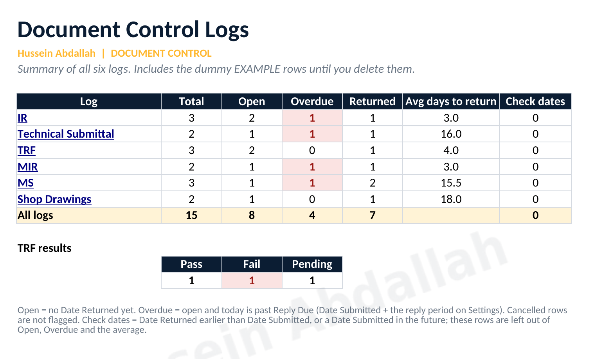

# Document Control Logs (Excel)

One Excel workbook with six document control logs: **IR, Technical Submittal, TRF (Test Results Form), MIR, MS, Shop Drawings**. Each log tracks when an item was submitted, when a reply is due, whether it is overdue and how long it waited. A Dashboard summarises all six. Dummy example data only.

Download: [Document-Control-Logs.xlsx](Document-Control-Logs.xlsx)

## What is inside

| Tab | Purpose |
|---|---|
| Start Here | How to use, abbreviations, limits |
| Dashboard | Per log: total, open, overdue, returned, average days to return, rows to check. Pass / Fail / Pending counts for TRF |
| IR, Technical Submittal, TRF, MIR, MS, Shop Drawings | 300 ready rows each, dropdowns, date checks, filters, frozen header |
| Settings | Reply period per log, status list, discipline list |

Each log has the same core columns (Ref No., Rev, Description, Discipline, Date Submitted, Reply Due, Date Returned, Status, Days Waiting, Flag, Remarks) plus a few columns of its own. The TRF log adds Test Type, Test Date, Tested By / Lab, Result (Pass / Fail / Pending) and Related Ref.

## How to use (English)

1. Open a log tab and add one row per submission. Fill the white columns only.
2. Reply Due, Days Waiting and Flag calculate by themselves.
3. Enter Date Returned when the reply arrives. The row then shows Closed.
4. Rows past their Reply Due with no Date Returned turn red and show OVERDUE.
5. Delete the rows marked EXAMPLE (clear the cells, keep the grey formula columns).
6. Change reply periods, statuses and disciplines on Settings to match your project.

## طريقة الاستخدام (بالعربي)

1. افتح تاب اللوج وضيف صف لكل مستند مقدَّم. املأ الخانات البيضاء بس.
2. تاريخ الرد المطلوب وأيام الانتظار والحالة (Flag) بتتحسب لوحدها.
3. اكتب Date Returned لما الرد يوصل، والصف هيظهر Closed.
4. أي صف عدّى موعد الرد ومفيهوش Date Returned بيتلون أحمر ويظهر OVERDUE.
5. امسح الصفوف المكتوب فيها EXAMPLE (امسح الخانات بس، وسيب الأعمدة الرمادي فيها المعادلات).
6. عدّل مدد الرد وقوائم الحالات والتخصصات من تاب Settings على حسب مشروعك.

## Checks that were run

The calculations were recalculated in LibreOffice and compared with an independent Python model on the example data, an empty workbook, and edge cases: submitted today, due exactly today, one day late, cancelled, returned the same day, returned before submitted, a future submission date, and data in the last row. No mismatches.

## Limits

- Not opened or tested in desktop Excel.
- The reply periods (7 days for IR, TRF and MIR; 14 days for Technical Submittal, MS and Shop Drawings), status names and disciplines are placeholders, not an approved project procedure.
- IR (Inspection Request), MIR (Material Inspection Request) and MS (Method Statement) use common construction meanings and are marked on the Start Here tab as assumed.
- Rows with a Date Returned earlier than the Date Submitted, or a future Date Submitted, are flagged CHECK DATES and left out of the open, overdue and average counts.
- A faint "Hussein Abdallah" watermark is placed as pictures over each sheet. It shows on screen and in print (checked in a LibreOffice render). In Excel the pictures may be selectable when clicked; if so, click a cell outside them or press Esc.
- All example rows are dummy data. No employer data.

## Notice

See NOTICE.md. © 2026 Hussein Abdallah. All rights reserved.
